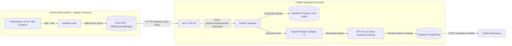

<div align="center">


# `{ Drafty }`

**Talk it out. I'll draft it.**  
*Voice-driven AI content structuring assistant for short-form creators — blending Apple Liquid Glass with crisp 1-bit pixel craft.*

<p>
  
  
  
  
  
</p>

</div>

---

## `[ 01 ]` Meet Drafty — The Three States

Drafty is a custom `24×24` 1-bit monochrome pixel companion rendered with nearest-neighbor sharpness (`FilterQuality.None`). Each state communicates what Drafty is doing at a glance:

<div align="center">

| `IDLE · READY` | `LISTENING · HOLD TO TALK` | `THINKING · STRUCTURING` |
| :---: | :---: | :---: |
|  |  |  |
| Gentle hover & periodic blink on the Home dock, ready to capture your next idea. | Press & hold Drafty to record with a voice-reactive RGB liquid-glass edge wave & live waveform. | Whisper transcribes your memo while GPT-4o mini structures hooks, script, shots & schedule. |

</div>

> Once saved or synced to **Drafted**, Drafty switches to `CELEBRATING` () with a crisp pixel sparkle and checkmark.

---

## `[ 02 ]` Core Features

- **Voice-First Push-to-Talk:** Press and hold Drafty on the notched liquid-glass dock to record; slide up to cancel; release to auto-draft.
- **Offline-First Resilience:** Voice memos recorded without signal are cached locally in Room (`OfflineQueueManager`) and auto-drafted the moment connectivity returns.
- **Structured Idea Containers:** Every voice dump becomes a 3-tab brief — **Script** (3 hooks, full caption/script, CTA, hashtags), **Creatives** (visual style, timestamped shot list, text overlays), and **Schedule** (customizable date, day & peak time slot).
- **One-Tap AI Hook Regeneration:** Hit `✦ Regenerate` on any container to generate 3 fresh, non-repeating opening hooks tailored to your brand voice.
- **Instant Copy & Native Share:** One-tap clipboard copy for scripts and shot lists, plus native Android Share Sheet export for the full brief.
- **Smart Search, Filter & Platform Badges:** Search ideas by title, pillar, or platform, filter by status (`All`, `Synced`, `Drafts`) or mainstream platform (`Instagram`, `TikTok`, `YouTube`, etc.), and spot platforms at a glance via vector brand badges.
- **First-Launch Onboarding & Brand Voice:** Airy 4-step onboarding introduces Drafty's states and captures your creator name, email, and brand voice prompt.

---

## `[ 03 ]` System Architecture



---

## `[ 04 ]` Tech Stack

| Layer | Stack |
| :--- | :--- |
| **Mobile App (`android/`)** | Kotlin, Jetpack Compose (Material 3), Navigation Compose, ViewModel + StateFlow, Room (KSP), Retrofit 2 + OkHttp 3, Moshi (KSP), `MediaRecorder` (AAC `.m4a`), `ConnectivityManager` |
| **Backend API (`backend/`)** | Python 3.12, FastAPI, Uvicorn, Pydantic v2 (`extra="forbid"`), `python-multipart`, `python-dotenv` |
| **AI Pipeline** | OpenAI Whisper (`whisper-1`) + OpenAI `gpt-4o-mini` Structured Outputs |
| **Database & Storage** | Supabase PostgreSQL (`user_profiles`, `voice_drafts`, `content_containers`) + Supabase Storage (`voice-drafts`) |
| **Deployment** | `render.yaml` Blueprint + `backend/Dockerfile` + Gradle `-PDRAFTY_API_URL` build injection |

---

## `[ 05 ]` Repository Structure

```text
Drafty/
├── android/                             # Native Kotlin + Jetpack Compose Android App
│   └── app/src/main/java/com/cs312/drafty/
│       ├── core/audio/                  # AudioRecorder.kt (.m4a MediaRecorder wrapper)
│       ├── core/network/                # OfflineQueueManager.kt (auto-sync on reconnect)
│       ├── data/local/                  # Room DB, DAO, Converters, Entities
│       ├── data/remote/                 # DraftyApiService, NetworkClient, ApiModels
│       ├── ui/components/               # DraftyMascot, Common, WaveformVisualizer,
│       │                                # LiquidGlassRecordingOverlay, PixelSpeechBubble
│       ├── ui/screens/                  # OnboardingScreen, HomeScreen, IdeaContainerScreen
│       ├── ui/theme/                    # Color, Shape, Type, Theme
│       └── MainActivity.kt              # DraftyNavHost
├── backend/                             # Python FastAPI Backend
│   ├── migrations/001_initial_schema.sql
│   ├── services/                        # ai_service.py & db_service.py
│   ├── tests/                           # test_voice_api.py & benchmark_week3.py
│   ├── Dockerfile                       # Production container image
│   ├── config.py                        # Dynamic .env settings loader
│   ├── main.py                          # FastAPI routes & flat error handlers
│   ├── models.py                        # Strict Pydantic v2 schemas
│   └── requirements.txt
├── docs/                                # Documentation, Benchmarks & Mascot Assets
│   ├── assets/mascot/                   # 1024x1024 crisp pixel PNG exports
│   ├── BRD.md
│   ├── Evaluation_Report.md
│   ├── Implementation.md
│   └── Progress.md
└── render.yaml                          # One-click Render cloud Blueprint
```

---

## `[ 06 ]` Getting Started

### 1. Supabase Database Setup
Run [`backend/migrations/001_initial_schema.sql`](backend/migrations/001_initial_schema.sql) in your Supabase **SQL Editor** to create `user_profiles`, `voice_drafts`, `content_containers`, triggers, and the `voice-drafts` storage bucket.

### 2. Run the FastAPI Backend Locally
```powershell
cd backend
python -m venv venv
.\venv\Scripts\activate
pip install -r requirements.txt
copy .env.example .env
# Fill in OPENAI_API_KEY, SUPABASE_URL, and SUPABASE_KEY in backend/.env
uvicorn main:app --reload --host 0.0.0.0 --port 8000
```
Verify at `http://localhost:8000/health` → `{"status": "ok"}`.

### 3. Run on Emulator or USB Android Device
```powershell
# Forward phone/emulator loopback port 8000 to your host backend
adb reverse tcp:8000 tcp:8000

# Build & install debug APK
cd android
.\gradlew.bat :app:installDebug
```

### 4. Deploy Publicly (Cloud Backend + Shareable APK)
1. Push this repo to GitHub and deploy `render.yaml` on [Render](https://render.com) (set `OPENAI_API_KEY`, `SUPABASE_URL`, `SUPABASE_KEY`).
2. Build a standalone APK pointed at your live HTTPS backend:
   ```powershell
   cd android
   .\gradlew.bat :app:assembleDebug -PDRAFTY_API_URL=https://your-drafty-api.onrender.com/
   ```
   Share `android/app/build/outputs/apk/debug/app-debug.apk` with anyone!

---

## `[ 07 ]` Tests & Documentation

```powershell
# Backend unit test suite (15 tests)
python -m unittest discover -s backend/tests -p "test_*.py" -v

# Android Kotlin compilation check
cd android && .\gradlew.bat :app:compileDebugKotlin --console=plain
```

- **[Business Requirements Document](docs/BRD.md)**
- **[Sprint Implementation Plan](docs/Implementation.md)**
- **[Progress Tracker](docs/Progress.md)**
- **[Week 3 Evaluation & Benchmark Report](docs/Evaluation_Report.md)**
