<div align="center">


# `{ Drafty }`

**Talk it out. I'll draft it.**  
_Voice-driven AI content structuring assistant for creators — seamlessly synced with [{ Drafted }](https://github.com/l4hgs/Drafted)._

<p>
  <a href="https://github.com/l4hgs/Drafty/releases/latest/download/Drafty-v1.0.apk"></a>
  <a href="https://drafty-vh1d.onrender.com/health"></a>
  <a href="https://github.com/l4hgs/Drafted"></a>
  
  
  
  
</p>

</div>

---

## `[ 00 ]` Download & Live API

- **Android App (APK):** [**Download `Drafty-v1.0.apk`**](https://github.com/l4hgs/Drafty/releases/latest/download/Drafty-v1.0.apk) _(or browse [All Releases](https://github.com/l4hgs/Drafty/releases/latest))_
  1. Tap the download link on your Android phone (Android 7.0+ / API 24+).
  2. Open `Drafty-v1.0.apk` and allow **Install unknown apps** for your browser if prompted.
  3. Complete the 5-step onboarding (sign in with **Google** or **Email + Password**, personalize your creator voice, grant Microphone permission), and hold Drafty to start drafting!
- **Companion Calendar App:** [**`l4hgs/Drafted`**](https://github.com/l4hgs/Drafted) — sign in with the exact same account to manage your scheduled posts on a full editorial calendar, production checklists, and publish bridge.
- **Live Cloud API:** `https://drafty-vh1d.onrender.com/`
  - Health Check: [`GET /health`](https://drafty-vh1d.onrender.com/health)
  - Email Verification Landing Page: [`GET /auth/verified`](https://drafty-vh1d.onrender.com/auth/verified)
  - Interactive OpenAPI Docs: [`/docs`](https://drafty-vh1d.onrender.com/docs)

---

## `[ 01 ]` Meet Drafty — The Three States

Drafty is a custom `24×24` 1-bit monochrome pixel companion rendered with nearest-neighbor sharpness (`FilterQuality.None`). Each state communicates what Drafty is doing at a glance:

<div align="center">

|                                      `IDLE · READY`                                       |                                                 `LISTENING · HOLD TO TALK`                                                  |                                             `THINKING · STRUCTURING`                                             |
| :---------------------------------------------------------------------------------------: | :-------------------------------------------------------------------------------------------------------------------------: | :--------------------------------------------------------------------------------------------------------------: |
|  |                          |                 |
|     Gentle hover & periodic blink on the Home dock, ready to capture your next idea.      | Press & hold Drafty to record (slide left/right to lock hands-free, slide up to cancel) with an RGB liquid-glass edge wave. | Whisper transcribes your memo while parallel Moderation + GPT-4o mini structure hooks, script, shots & schedule. |

</div>

> Once saved or synced to **Drafted**, Drafty switches to `CELEBRATING` () with a crisp pixel sparkle and checkmark.

---

## `[ 02 ]` Core Features

- **Voice-First Push-to-Talk & Hands-Free Lock:** Press and hold Drafty on the notched liquid-glass dock to record; **slide left or right to engage Hands-Free Lock** for longer brain-dumps; slide up to cancel; release or tap **Stop & Draft** to process — backed by tactile `HapticChoreographer` cues and `GlassToast` feedback.
- **Swipeable Idea Container (`Script` · `Creatives` · `Schedule`):** Foundation `HorizontalPager` with a Drafted-style jet-black segmented control, **tap-to-select Primary Hook** (automatically placed first when copying, sharing, or syncing to Drafted), unified inline **Edit / Cancel** (including shot-list editing), and a responsive **two-pane landscape layout**.
- **One-Tap AI Hook Regeneration & Conflict-Free Scheduling:** Hit `✦ Regenerate` to generate 3 fresh hooks tailored to your brand voice; Drafty inspects your recently scheduled dates to avoid calendar double-booking and deterministically validates weekdays.
- **Drafted-Aligned Library & Swipe-to-Delete with Undo:** Search ideas by title, pillar, or platform; filter by `All`, `Synced`, `Drafts`, or platform; view `IDEAS · SYNCED · DRAFTS` stats and `"Hook: ..."` preview cards; swipe left to delete with a floating frosted-glass **Undo** toast.
- **Offline-First Resilience & Fast Pipeline:** Memos recorded offline queue in Room (`OfflineQueueManager`) and auto-sync when connectivity returns. On the backend, OpenAI Moderation runs in parallel with GPT-4o mini, audio archival uploads run non-blocking, and Drafty fires a silent `/health` warm-up ping on launch.
- **5-Step Mandatory Onboarding & Unified Auth:** Enlarged animated Drafty mascot, **Email + Password** (with visibility toggle, HTTPS email verification page, and 60s resend cooldown) + **Continue with Google**, followed by Brand Name & Brand Voice personalization.

---

## `[ 03 ]` Companion Integration — `{ Drafty }` ↔ [`Drafted`](https://github.com/l4hgs/Drafted)

Drafty and [**Drafted**](https://github.com/l4hgs/Drafted) form a single creator ecosystem connected through a **shared Supabase project** and **unified single-account authentication**:

1. **One Account for Both Apps (`Supabase Auth`):**
   - Users sign up or sign in once with **Email + Password** or **Google OAuth** (`drafty://auth-callback`, `drafted://auth-callback`, and HTTPS email confirmation via `https://drafty-vh1d.onrender.com/auth/verified`).
   - An `on_auth_user_created` database trigger automatically initializes `public.user_profiles` so both apps share the same `auth.uid()`.
2. **Direct Calendar Sync (`POST /api/v1/containers/{id}/schedule-to-drafted`):**
   - When you tap **Schedule to Drafted** in Drafty, the FastAPI backend verifies your Supabase Bearer JWT and upserts the structured draft directly into Drafted's `public.posts` table under your `auth.uid()`.
   - Drafty automatically maps your **selected primary hook** (`hook_preview`), **canonical platforms** (`tiktok`, `instagram`, `youtube`, `linkedin`), **format type** (`short_form`, `carousel`, `long_video`, `brand_deal`), **caption + CTA + hashtags**, and **scheduled date/time** (`status = 'to_shoot'`).
3. **1-Tap App Handoff & Auto-Refresh:**
   - Tapping **View in Drafted →** in Drafty's `ScheduleTab` or `CelebrationOverlay` launches Drafted (`com.example.drafted`) directly (or copies a formatted schedule summary if Drafted isn't installed).
   - Drafted auto-syncs with Supabase on resume so newly scheduled Drafty ideas appear immediately on Drafted's Calendar and Tasks views.

---

## `[ 04 ]` System Architecture

```mermaid
flowchart LR
    subgraph Client ["Drafty Android (Kotlin + Jetpack Compose)"]
        Auth["SupabaseAuthManager\n(Keystore AES-GCM + Google OAuth)"]
        UI["Onboarding / Home / Idea Container"] -->|AAC .m4a| Rec["AudioRecorder"]
        Rec -->|Offline-First Cache| Room[("Room DB + OfflineQueueManager")]
    end

    Room -->|HTTPS Bearer JWT + Multipart| Net["Wi-Fi / 4G·5G"]

    subgraph Cloud ["FastAPI Backend on Render & OpenAI"]
        Net -->|POST /api/v1/voice/transcribe-and-parse| API["FastAPI Gateway\n(JWT Verify + Rate Limit + Security Headers)"]
        API -->|Non-Blocking Upload| Bucket[("Supabase Storage: voice-drafts")]
        API -->|Speech-to-Text| Whisper["OpenAI Whisper (whisper-1)"]
        Whisper -->|Parallel Moderation + Parse| LLM["omni-moderation-latest +\nGPT-4o mini (Strict Pydantic)"]
        LLM -->|Persists Draft & Container| DB[("Shared Supabase PostgreSQL\n+ Auth + Strict RLS")]
    end

    API -->|"POST /schedule-to-drafted -> upsert public.posts"| DB
    DB <-->|"auth.uid Sync + Realtime"| Drafted["Drafted Companion App\n(Flutter · l4hgs/Drafted)"]
```



---

## `[ 05 ]` Security & AI Safety

- **Unified JWT Auth & Ownership Checks (IDOR Protection):** FastAPI verifies Supabase Bearer tokens via `backend/auth.py` and enforces `user_id` ownership across `GET`, `PATCH`, `DELETE`, `regenerate-hooks`, and `schedule-to-drafted`.
- **Strict Row-Level Security (RLS):** Migration [`003_harden_rls_auth_only.sql`](backend/migrations/003_harden_rls_auth_only.sql) locks all Drafty and Drafted tables (`user_profiles`, `voice_drafts`, `content_containers`, `posts`, `subtasks`, `radar_events`, `checklist_presets`, `milestone_stickers`) strictly to `auth.uid()`.
- **Encrypted On-Device Token Storage & Clean Sign-Out:** `SupabaseAuthManager` encrypts `access_token` and `refresh_token` at rest using **AndroidKeyStore AES-256-GCM**. Signing out wipes Room containers, clears pending offline `.m4a` audio files, and returns immediately to Onboarding.
- **Transport & Build Hardening:** `android:allowBackup="false"`, HTTPS-only `network_security_config.xml` (loopback HTTP allowed only for local `127.0.0.1` / `10.0.2.2` dev), and release-safe `HttpLoggingInterceptor` (`BuildConfig.DEBUG` only).
- **API Abuse & AI Guardrails:** Sliding-window AI rate limiter (`429 RATE_LIMITED`), HTTP security headers middleware (`X-Content-Type-Options`, `X-Frame-Options`, `Referrer-Policy`, `Cache-Control: no-store` on `/auth/*`), and layered **OpenAI Moderation + prompt-injection refusal** (`422 CONTENT_BLOCKED`).

---

## `[ 06 ]` Tech Stack

| Layer                        | Stack                                                                                                                                                                                                                                       |
| :--------------------------- | :------------------------------------------------------------------------------------------------------------------------------------------------------------------------------------------------------------------------------------------ |
| **Mobile App (`android/`)**  | Kotlin, Jetpack Compose (Material 3), Foundation `HorizontalPager`, Navigation Compose, ViewModel + StateFlow, Room (KSP), Retrofit 2 + OkHttp 3, Moshi (KSP), AndroidKeyStore AES-GCM, `MediaRecorder` (AAC `.m4a`), `ConnectivityManager` |
| **Backend API (`backend/`)** | Python 3.12, FastAPI, Uvicorn, Pydantic v2 (`extra="forbid"`), `python-multipart`, `python-dotenv`                                                                                                                                          |
| **AI & Safety Pipeline**     | OpenAI Whisper (`whisper-1`), OpenAI Moderation (`omni-moderation-latest`), OpenAI `gpt-4o-mini` Structured Outputs                                                                                                                         |
| **Database, Auth & Storage** | Shared Supabase Project (`auth.users`, `user_profiles`, `voice_drafts`, `content_containers`, Drafted `posts` / `subtasks` / `radar_events` / `checklist_presets` / `milestone_stickers`) + Supabase Storage (`voice-drafts`)               |
| **Companion App**            | [{ Drafted }](https://github.com/l4hgs/Drafted) (Flutter + Riverpod + `supabase_flutter`)                                                                                                                                                   |
| **Deployment**               | `render.yaml` Blueprint + `backend/Dockerfile` + Gradle `local.properties` / `-PDRAFTY_API_URL` build injection                                                                                                                             |

---

## `[ 07 ]` Repository Structure

```text
Drafty/
├── android/                             # Native Kotlin + Jetpack Compose Android App
│   └── app/src/main/
│       ├── res/xml/network_security_config.xml
│       └── java/com/cs312/drafty/
│           ├── core/audio/              # AudioRecorder.kt (.m4a MediaRecorder wrapper)
│           ├── core/auth/               # SupabaseAuthManager.kt (GoTrue + Keystore AES-GCM)
│           ├── core/network/            # OfflineQueueManager.kt (auto-sync & sign-out wipe)
│           ├── data/local/              # Room DB, DAO, Converters, Entities
│           ├── data/remote/             # DraftyApiService, NetworkClient, ApiModels
│           ├── ui/components/           # DraftyMascot, Common (GlassToast, Haptics, Pixel Icons),
│           │                            # WaveformVisualizer, LiquidGlassRecordingOverlay, PixelSpeechBubble
│           ├── ui/screens/              # OnboardingScreen, HomeScreen, IdeaContainerScreen
│           ├── ui/theme/                # Color (Drafted palette), Shape, Type (Inter + Mono), Theme
│           └── MainActivity.kt          # DraftyNavHost + OAuth deep-link callback
├── backend/                             # Python FastAPI Backend
│   ├── migrations/
│   │   ├── 001_initial_schema.sql       # Drafty tables & voice-drafts bucket
│   │   ├── 002_unified_drafted_and_auth.sql # Drafted tables + auth.users trigger + unified RLS
│   │   └── 003_harden_rls_auth_only.sql # Strict auth.uid()-only RLS hardening
│   ├── services/                        # ai_service.py (parallel moderation + parse) & db_service.py
│   ├── tests/                           # test_voice_api.py & benchmark_week3.py
│   ├── auth.py                          # Supabase JWT Bearer verification dependency
│   ├── Dockerfile                       # Production container image
│   ├── config.py                        # Dynamic .env settings loader (incl. REQUIRE_AUTH)
│   ├── main.py                          # FastAPI routes, /auth/verified, rate limiter & security headers
│   ├── models.py                        # Strict Pydantic v2 schemas
│   └── requirements.txt
├── docs/                                # Documentation, Benchmarks & Mascot Assets
│   ├── assets/mascot/                   # Crisp pixel PNGs & 512x512 animated GIFs
│   ├── UI_Design_System.md
│   ├── BRD.md
│   ├── Evaluation_Report.md
│   ├── Implementation.md
│   └── Progress.md
└── render.yaml                          # One-click Render cloud Blueprint
```

---

## `[ 08 ]` Getting Started

### 1. Shared Supabase Database & Auth Setup

1. Run the SQL migrations in order inside your Supabase **SQL Editor**:
   - [`backend/migrations/001_initial_schema.sql`](backend/migrations/001_initial_schema.sql)
   - [`backend/migrations/002_unified_drafted_and_auth.sql`](backend/migrations/002_unified_drafted_and_auth.sql)
   - [`backend/migrations/003_harden_rls_auth_only.sql`](backend/migrations/003_harden_rls_auth_only.sql)
2. In **Supabase Dashboard → Authentication → Providers**, enable **Email** and **Google**.
3. In **Authentication → URL Configuration**:
   - **Site URL:** `https://drafty-vh1d.onrender.com/auth/verified`
   - **Redirect URLs:** `drafty://auth-callback`, `drafted://auth-callback`, `https://drafty-vh1d.onrender.com/auth/verified`

### 2. Configure Android Keys (`android/local.properties`)

Add your Supabase project credentials (never committed to Git):

```properties
DRAFTY_SUPABASE_URL=https://<your-project>.supabase.co
DRAFTY_SUPABASE_ANON_KEY=<your-anon-key>
```

_(By default `API_BASE_URL` points to `https://drafty-vh1d.onrender.com/`. Override locally with `-PDRAFTY_API_URL=http://127.0.0.1:8000/`.)_

### 3. Run the FastAPI Backend Locally (Optional)

```powershell
cd backend
python -m venv venv
.\venv\Scripts\activate
pip install -r requirements.txt
copy .env.example .env
# Fill in OPENAI_API_KEY, SUPABASE_URL, SUPABASE_KEY (and optionally REQUIRE_AUTH=true)
uvicorn main:app --reload --host 0.0.0.0 --port 8000
```

Verify at `http://localhost:8000/health` → `{"status": "ok"}`.

### 4. Build & Install on Android

```powershell
cd android
.\gradlew.bat :app:installDebug
```

### 5. Deploy Publicly (Cloud Backend + Shareable APK)

1. Deploy `render.yaml` on [Render](https://render.com) with `OPENAI_API_KEY`, `SUPABASE_URL`, `SUPABASE_KEY`, and `REQUIRE_AUTH=true`.
   - Current live instance: `https://drafty-vh1d.onrender.com/`
2. Build a standalone APK pointed at your live HTTPS backend:
   ```powershell
   cd android
   .\gradlew.bat :app:assembleDebug -PDRAFTY_API_URL=https://drafty-vh1d.onrender.com/
   ```
3. Upload the APK to a [GitHub Release](https://github.com/l4hgs/Drafty/releases/new) so Android users can download it directly.

---

## `[ 09 ]` Tests & Documentation

```powershell
# Backend unit test suite (16 tests)
python -m unittest discover -s backend/tests -p "test_*.py" -v

# Android Kotlin compilation check
cd android && .\gradlew.bat :app:compileDebugKotlin --console=plain
```

- **[Companion App Repository — Drafted](https://github.com/l4hgs/Drafted)**
- **[UI Design System & Interface Guide](docs/UI_Design_System.md)**
- **[Business Requirements Document](docs/BRD.md)**
- **[Sprint Implementation Plan](docs/Implementation.md)**
- **[Progress Tracker](docs/Progress.md)**
- **[Week 3 Evaluation & Benchmark Report](docs/Evaluation_Report.md)**
