# **BUSINESS REQUIREMENTS DOCUMENT (BRD)**

## **Project Name: Drafty.**

### **1\. Project Overview & Executive Summary**

**Drafty.** is an innovative, voice-driven mobile AI assistant application designed for digital content creators, student leaders, and professionals. It eliminates "blank page syndrome" and the friction of mobile typing by allowing users to speak unstructured, stream-of-consciousness voice notes while on-the-go. The app records, compresses, and transmits audio payloads over cellular or Wi-Fi networks to a cloud backend where AI transcribes, parses, and structures the input into a multi-tab content container complete with titles, platform-specific hooks, captions, visual direction, schedules, and metadata—ready for direct synchronization with the **Drafted** workspace.

### **2\. Project Scope & Objectives**

#### **2.1 General Objective**

To develop a functional mobile application prototype in **Kotlin** that captures unscripted voice memos, transmits them over wireless networks, and translates them into structured content containers in under 5 seconds.

#### **2.2 Specific Objectives**

1. **Low-Latency Voice Capture:** Implement native Android audio recording modules optimized for stability and minimal file size.

2. **Network Resilience & Mobility:** Support seamless transitions and data synchronization across Wi-Fi and 4G/5G cellular networks using Mobile IP principles.

3. **Automated AI Parsing:** Leverage cloud-based Speech-to-Text (Whisper) and LLM parsing engines to automatically generate structured multi-platform content kits.

4. **Direct Ecosystem Sync:** Provide a one-tap synchronization mechanism to push finalized content containers directly into the **Drafted** workspace database.

#### **2.3 Scope Boundaries**

- **In Scope:** Android mobile app UI (Jetpack Compose), audio recorder, local SQLite/Room caching queue, HTTPS REST API client, cloud backend (FastAPI \+ Supabase), and Drafted synchronization.

- **Out of Scope:** Direct automated auto-posting to external social media platforms (TikTok, Instagram, etc.); the application lifecycle concludes at the Drafted scheduling queue.

### **3\. Target Users & Stakeholders**

- **Primary Users:** Content creators, student organization officers (e.g., Junior Philippine Computer Society members), and mobile professionals who need to bank ideas quickly while walking, commuting, or working away from a desktop.

- **Evaluators / Course Instructors:** Faculty members of the College of Informatics and Computing Sciences assessing mobile computing competency, network efficiency, and systems design.

### **4\. Functional Requirements**

| Feature ID | Feature Name                        | Description                                                                                                                                                                                                                               | Priority |
| :--------- | :---------------------------------- | :---------------------------------------------------------------------------------------------------------------------------------------------------------------------------------------------------------------------------------------- | :------- |
| **FR-01**  | Hold & Lock-to-Record Voice Capture | The user can press and hold Drafty on the home screen (or slide left/right to lock hands-free, slide up to cancel) to instantly record an unscripted audio brain-dump.                                                                    | High     |
| **FR-02**  | Local Audio Caching                 | Recorded audio is temporarily saved in local storage (Room database) with an auto-retry queue to prevent data loss during poor connectivity or network handovers.                                                                         | High     |
| **FR-03**  | Network Adaptive Upload             | The app packages and transmits audio payloads securely via HTTPS over the active network interface (Wi-Fi or Cellular) with Bearer JWT authentication.                                                                                    | High     |
| **FR-04**  | AI Content Parsing & Moderation     | The backend transcribes audio (Whisper), runs safety moderation (`omni-moderation-latest`), and parses intent via GPT-4o mini Structured Outputs into a structured container (Title, 3 Hooks, Script, Creatives, Conflict-Free Schedule). | High     |
| **FR-05**  | Interactive Container UI            | Users can swipe across tabbed interfaces (`Script`, `Creatives`, `Schedule`), tap to choose a Primary Hook, regenerate hooks, and edit all fields (including shot lists) inline.                                                          | Medium   |
| **FR-06**  | Live Drafted Synchronization        | A single tap on "Schedule to Drafted" upserts the structured package directly into Drafted's shared Supabase `public.posts` calendar table and offers 1-tap handoff into the Drafted companion app.                                       | High     |
| **FR-07**  | Unified Creator Authentication      | Users sign in with Email/Password (with HTTPS email verification) or Google OAuth via Supabase Auth, sharing a single authenticated identity across Drafty and Drafted.                                                                   | High     |

### **5\. Non-Functional & Mobile Computing Requirements**

- **Performance & Latency:** End-to-end processing time from finishing a voice recording to rendering the structured container on the device must be under **5.0 seconds** in ≥ 90% of warm test trials.

- **Network Reliability:** Audio packet transmission success rate must be ≥ 98% under standard 4G LTE and Wi-Fi conditions. Session state must be preserved during network handovers.

- **Security & Privacy:** All data payloads in transit are encrypted using TLS 1.3 over HTTPS (`network_security_config.xml` restricts cleartext to localhost debug). Auth tokens are encrypted at rest with **AndroidKeyStore AES-256-GCM**, `android:allowBackup` is disabled, backend routes enforce Supabase JWT verification + per-user IDOR checks + AI rate limiting (`15 req / 5 min`) + HTTP security headers, Supabase enforces strict `auth.uid()` RLS policies, and Sign Out wipes local Room records and queued audio files.

- **Power Efficiency:** Radio usage optimized via batch uploading and idle states to minimize battery drain on mobile devices.

### **6\. Proposed System Architecture & Data Flow**

#### **6.1 System Topology Diagram (Landscape Mermaid)**

```mermaid
graph LR
    subgraph Client ["Mobile Client - Kotlin (Drafty v2.0)"]
        Auth["Supabase Auth + KeyStore"]
        UI["Compose UI & Navigation"] -->|Records| AudioRec["Audio Recorder"]
        AudioRec -->|Saves| LocalCache["Room Offline Queue"]
    end

    LocalCache -->|HTTPS + Bearer JWT| WiFi["Network / Wi-Fi / 5G"]

    subgraph Cloud ["Backend & AI (Render + OpenAI)"]
        WiFi -->|Handoff| API["FastAPI Gateway + Rate Limiter"]
        API -->|Transcribes| Transcriber["Whisper ASR"]
        Transcriber -->|Parallel Safety + Parse| Parser["Moderation + GPT-4o mini"]
        Parser -->|Stores JSON + Posts| DB[("Unified Supabase DB + RLS")]
    end

    DB <-->|"auth.uid Sync"| Drafted["Drafted Companion App (Flutter)"]

    classDef client fill:#f9f,stroke:#333,stroke-width:2px;
    classDef net fill:#bbf,stroke:#333,stroke-width:2px;
    classDef cloud fill:#bfb,stroke:#333,stroke-width:2px;
    classDef ext fill:#ff9,stroke:#333,stroke-width:2px;

    class Auth,UI,AudioRec,LocalCache client;
    class WiFi net;
    class API,Transcriber,Parser,DB cloud;
    class Drafted ext;
```

#### **6.2 Technology Stack Breakdown**

| Layer                     | Component                                 | Classification    | Justification                                                                                                           |
| :------------------------ | :---------------------------------------- | :---------------- | :---------------------------------------------------------------------------------------------------------------------- |
| **Mobile Frontend**       | Kotlin (Jetpack Compose / Android SDK)    | Custom-Built      | Provides modern declarative UI, responsive two-pane layouts, and native access to `MediaRecorder` and AndroidKeyStore.  |
| **Local Storage**         | Android Room Database                     | Existing / Reused | Ensures robust local caching and offline-first queue management.                                                        |
| **Network Link**          | Wi-Fi (IEEE 802.11) & 4G/5G Cellular      | Existing / Reused | Handles outdoor mobility and high-speed indoor batch syncing.                                                           |
| **Backend API**           | Python / FastAPI (Hosted on Render)       | Custom-Built      | High-performance asynchronous endpoint handling, JWT verification, rate limiting, and HTTPS `/auth/verified` callback.  |
| **AI / ASR Engine**       | OpenAI Whisper, Moderation & GPT-4o mini  | Existing / Reused | Industry-standard transcription, safety moderation, and schema-constrained JSON parsing.                                |
| **Auth, Database & Sync** | Supabase (Auth + PostgreSQL + Storage)    | Existing / Reused | Unified authentication and cloud repository with strict `auth.uid()` RLS connecting Drafty to Drafted (`public.posts`). |
| **Companion App**         | Drafted (Flutter / Dart, `l4hgs/Drafted`) | Integrated        | Shared-account production calendar receiving synced Drafty containers automatically.                                    |

### **7\. Evaluation & Success Metrics**

1. **Processing Latency:** Tracked via client performance logs; target is `< 5.0` seconds for ≥ 90% of warm test runs.

2. **Parsing Accuracy:** Manual evaluation of generated content containers against original voice inputs; target is ≥ 90% semantic relevance without hallucination.

3. **Network Resilience:** Simulated network switching (Wi-Fi to Cellular mid-upload) across 10 trials; target is 100% recovery without app failure.
