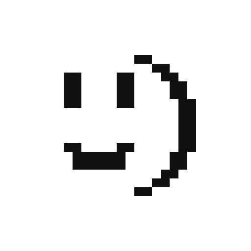
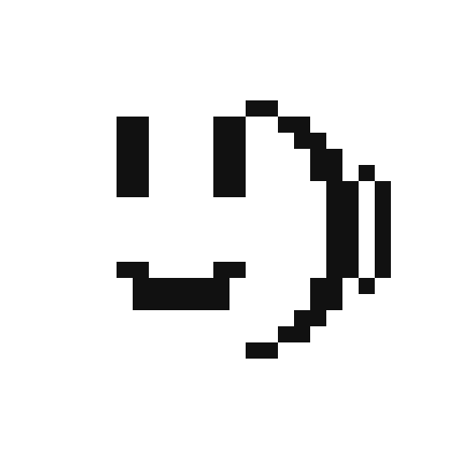
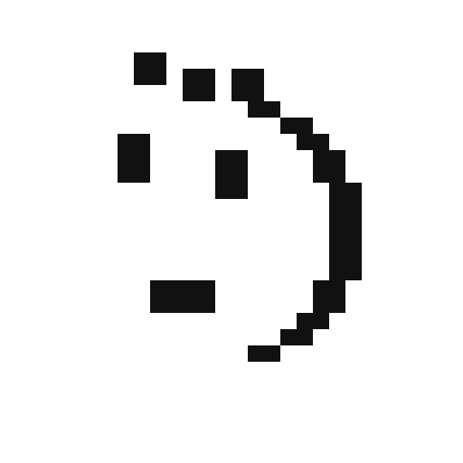
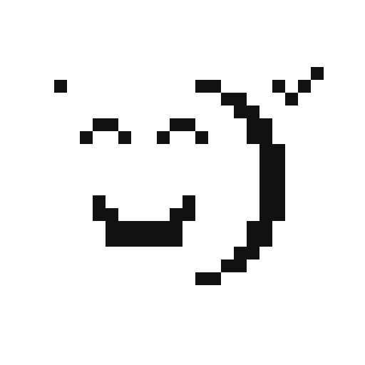
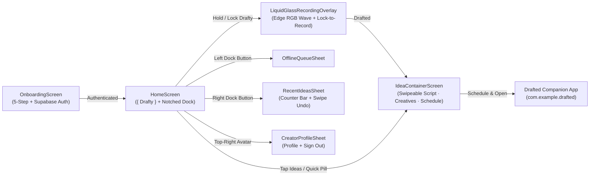

# **`{ Drafty }` — UI Design System & Interface Guide**

**Design Philosophy:** *Apple Liquid Glass × 1-Bit Pixel Craft (Drafted-Aligned v2.0)*  
**Platform:** Native Android (Kotlin + Jetpack Compose Material 3)  
**Last Updated:** November 27, 2026

---

## 1. Visual Language

Drafty pairs **Apple-inspired borderless soft UI** (cool `#F7F7F9` off-white canvas, pure `#FFFFFF` borderless cards with soft ambient shadows, luminous frosted glass controls, and clean neo-grotesque typography) with **strictly monochrome 1-bit pixel art** reserved for Drafty, micro-icons, and the `{ Drafty }` wordmark.

- **Quiet Canvas, Tactile Focal Points:** Generous negative space keeps cognitive load low while voice recording and content structuring take center stage.
- **Luminous Glassmorphism:** Floating controls (`GlassButton`, `GlassIconButton`, notched bottom dock, tab switcher, and floating action dock) use diagonal frosted white gradients (`80%–94%` opacity) with bright specular borders so ambient background colors glow softly around and beneath them without hurting text legibility.
- **Purposeful Ambient Color:** Color is never loud or decorative — each screen/tab carries its own subtle ambient aura (pink-to-orange ombré around Drafty on Home; muted Blue, Dusty Rose, and Forest Sage across `Script`, `Creatives`, and `Schedule`; rotating prismatic RGB edge wave while recording).

---

## 2. Design Tokens

### 2.1 Core Surfaces & Semantic Colors ([Color.kt](../android/app/src/main/java/com/cs312/drafty/ui/theme/Color.kt))

| Token | Hex | Usage |
| :--- | :--- | :--- |
| `AppBackground` | `#F7F7F9` | Global screen canvas |
| `CardSurface` | `#FFFFFF` | Borderless elevated cards & modal sheets |
| `SoftWell` | `#F0F0F3` | Neutral inner wells, search bars, and inactive pills |
| `InkBlack` | `#111111` | Primary text, 1-bit pixel mascot, and pixel micro-icons |
| `MutedGray` | `#6E6E73` | Secondary copy, timestamps, and inactive labels |
| `SubtleDivider` | `#E5E5EA` | Hairline dividers and sheet drag handles |
| `StatusGreen` | `#34C759` | `● Synced` status indicator |
| `StatusRed` | `#FF3B30` | Offline queue dot, slide-to-cancel tint, destructive actions |
| `ShadowAmbient` / `ShadowSpot` | `#0D000000` / `#14000000` | Soft elevation shadows on borderless cards |

### 2.2 Editorial Tab & Ambient Palettes ([IdeaContainerScreen.kt](../android/app/src/main/java/com/cs312/drafty/ui/screens/IdeaContainerScreen.kt) & [HomeScreen.kt](../android/app/src/main/java/com/cs312/drafty/ui/screens/HomeScreen.kt))

| Context | Ambient Patch / Ombré | Solid Muted Tile Fill | Text / Icon Accent |
| :--- | :--- | :--- | :--- |
| **Home (Drafty Dock)** | Radial `#FF5CA8` (Pink) → `#FF7E79` → `#FF9652` (Orange) (`0.34×` height) | Frosted pearl-white (`#FCFFFFFF` → `#E8FFFFFF`) | `#111111` |
| **Script Tab** | Sky Blue (`#38BDF8` / `#60A5FA`) | Muted Slate Blue `#E9EFF5` (Pill: `#DFE8F0`) | `#3B6790` |
| **Creatives Tab** | Rose Red (`#F43F5E` / `#FB7185`) | Muted Dusty Rose `#F3EAEB` (Pill: `#EBDDDF`) | `#9B4A55` |
| **Schedule Tab** | Emerald Mint (`#34D399` / `#4ADE80`) | Muted Sage `#E9F0EC` | `#3B6E57` |
| **Content Pillar Chip** | — | Muted Lavender-Slate `#EAE8F2` | `#4E4668` |
| **Recording Edge Wave** | Rotating RGB Sweep (`#38BDF8` → `#A855F7` → `#F43F5E` → `#FB923C` → `#34D399`) | Full-viewport frosted `#F5FFFFFF` → `#EBFAFAFC` | `#111111` / `#E53935` (cancel) |

### 2.3 Shapes ([Shape.kt](../android/app/src/main/java/com/cs312/drafty/ui/theme/Shape.kt))

| Token | Radius / Shape | Usage |
| :--- | :--- | :--- |
| `CardShape` | `RoundedCornerShape(20.dp)` | Outer borderless cards (`SoftCard`) |
| `InnerTileShape` | `RoundedCornerShape(12.dp)` | Hook tiles, shot items, schedule tiles, text fields |
| `PillShape` | `CircleShape` | Chips, glass buttons, active tab pill |
| `SheetTopShape` | `RoundedCornerShape(topStart = 28.dp, topEnd = 28.dp)` | Modal bottom sheets (`OfflineQueueSheet`, `RecentIdeasSheet`, `CreatorProfileSheet`) |
| `NotchedDockShape` | Custom `GenericShape` (`54.dp` cradle arc) | Home bottom navbar cradling the `94.dp` circular Drafty button with zero overlap |

### 2.4 Typography ([Type.kt](../android/app/src/main/java/com/cs312/drafty/ui/theme/Type.kt))

Powered by bundled **Inter** (`res/font/inter_font.ttf`) with tight Apple-style negative tracking on headings, plus `FontFamily.Monospace` for the live recording timer and a custom `33×9` 1-bit pixel matrix (`PixelDraftyWordmark`) for **`{ Drafty }`**.

| Style | Size / Line Height | Weight | Letter Spacing |
| :--- | :---: | :---: | :---: |
| `headlineLarge` | `28.sp / 34.sp` | Bold | `-0.6.sp` |
| `headlineMedium` | `24.sp / 30.sp` | Bold | `-0.5.sp` |
| `headlineSmall` | `20.sp / 26.sp` | SemiBold | `-0.4.sp` |
| `titleLarge` | `18.sp / 24.sp` | SemiBold | `-0.3.sp` |
| `titleMedium` | `16.sp / 22.sp` | SemiBold | `-0.2.sp` |
| `bodyLarge` | `15.sp / 22.sp` | Normal | `0.sp` |
| `bodyMedium` | `14.sp / 20.sp` | Normal | `0.sp` |
| `labelLarge` | `14.sp / 18.sp` | SemiBold | `0.sp` |
| `labelMedium` | `12.sp / 16.sp` | Medium | `+0.4.sp` |

---

## 3. Mascot & Pixel Iconography

### 3.1 Drafty Mascot ([DraftyMascot.kt](../android/app/src/main/java/com/cs312/drafty/ui/components/DraftyMascot.kt))

A `24×24` 1-bit monochrome (`#111111` on transparent) Finder-style `:` + `)` pixel smiley rendered via `ImageBitmap` with `FilterQuality.None` and integer cell snapping.

| State | Visual | Animation |
| :--- | :---: | :--- |
| **`IDLE`** |  | Subtle `±3.dp` vertical hover float + periodic `140ms` blink every `3.5s`. |
| **`LISTENING`** |  | Wide alert eyes, voice-amplitude scale pulse, and 2-frame pixel sound-wave arcs radiating off the `)` curve. |
| **`THINKING`** |  | 4-frame alternating eyes + bouncing 3-dot orbital pixel loader above the face. |
| **`CELEBRATING`** |  | Calm happy `^ ^` eyes, twinkling pixel sparkle + checkmark, gentle `1.04×` scale-in (no repetitive jumping). |

### 3.2 Reusable Primitives ([Common.kt](../android/app/src/main/java/com/cs312/drafty/ui/components/Common.kt))
- **Glass Controls & Feedback:** `GlassIconButton` (`44.dp`–`48.dp` circular frosted glass), `GlassButton` (light frosted, dark charcoal emphasis, and destructive red variants), `GlassToastState` / `GlassToastHost` (frosted floating toasts with optional **Undo** action), `HapticChoreographer`, `Modifier.springPressScale()`, and `SoftCard` hairline borders aligned with **Drafted**.
- **1-Bit Pixel Micro-Icons (`PixelIconGrid`):** `PixelUserIcon` (`14×14` circled avatar), `PixelQueueIcon`, `PixelIdeasIcon`, `PixelBackIcon`, `PixelEditIcon`, `PixelCheckIcon`, `PixelSendIcon`, `PixelTrashIcon`, `PixelShareIcon`, `PixelCopyIcon`, `PixelSparkleIcon`, `PixelSyncIcon`, `PixelCloseIcon`, `PixelLockIcon`, `PixelEyeIcon`, `PixelEyeOffIcon`.
- **Mainstream Social Media Badges (`PlatformLogoBadge` + `canonicalPlatform`):** Vector brand logos for **Instagram**, **TikTok**, **YouTube**, **Facebook**, **X**, **LinkedIn**, and **Threads**, automatically deduplicating sub-formats (e.g., *Instagram Stories / Reels / Post* → **Instagram**).

---

## 4. Screen-by-Screen Architecture

### 4.1 Onboarding & Auth ([OnboardingScreen.kt](../android/app/src/main/java/com/cs312/drafty/ui/screens/OnboardingScreen.kt))
- Mandatory 5-page swipeable `HorizontalPager` with responsive two-pane landscape support and subtle bottom ambient glow:
  1. **`{ Drafty }` Welcome Hero** (`IDLE`) matching the Home screen aesthetic.
  2. **Hold or Lock to Talk** (`LISTENING`) — explains hold-to-record, slide-to-lock hands-free recording, slide-up-to-cancel, and offline auto-save.
  3. **Structured in Seconds** (`THINKING`) — introduces `Script`, `Creatives`, and `Schedule`.
  4. **Set Up Your Voice** (`CELEBRATING`) — collects `brand_name` and optional `brand_voice_prompt`.
  5. **Unified Account Auth** — Email + Password (with `PixelEyeIcon`/`PixelEyeOffIcon` visibility toggle and reassuring `EmailVerificationWaitingModal` with 60s resend cooldown) or Google OAuth (`drafty://auth-callback`), synced seamlessly with **Drafted**.

### 4.2 Home Screen ([HomeScreen.kt](../android/app/src/main/java/com/cs312/drafty/ui/screens/HomeScreen.kt))
- **Top-Right:** `44.dp` circular `GlassIconButton` with `14×14` pixelated `PixelUserIcon`.
- **Upper-Middle Optical Center (`BiasAlignment(0f, -0.18f)`):** `"hey, <name>"` (defaults to `"hey, Drafter"`), pixel **`{ Drafty }`** wordmark, and a compact frosted quick-resume pill (`Latest: … →` or `● N offline note ready to sync →`). Automatically adapts to a **two-pane landscape layout** on wide viewports.
- **Background Layer:** 3 softly drifting rounded ambient prompt bubbles ([PixelSpeechBubble.kt](../android/app/src/main/java/com/cs312/drafty/ui/components/PixelSpeechBubble.kt)) cycling contextual prompts every `6s`; tapping any bubble pins it as an active recording prompt.
- **Bottom Notched Liquid-Glass Dock (`zIndex 2`):**
  - Centered pink-to-orange radial ombré (`0.34×` height) behind Drafty.
  - Smooth semicircular notched glass pill (`64.dp` tall, `44.dp` horizontal inset) housing `PixelQueueIcon` (left, with `8.dp` coral dot when queued) and `PixelIdeasIcon` (right).
  - Protruding `94.dp` frosted pearl-white circular Drafty button (`-30.dp` offset, `20.dp` shadow) nested cleanly inside the notch with a `7.dp` gap and zero glass overlap.
  - While holding, the bottom Drafty sprite morphs into a voice-pulsing `ThumbAnchorRing` with directional cues to slide left/right to **Lock** or slide up to **Cancel**.
- **Recent Ideas Sheet:** Drafted-aligned `IDEAS · SYNCED · DRAFTS` monospace (`MonoFont`) counter bar, relative creation dates (`Today` / `Yesterday` / `MMM d`), `"Hook: ..."` preview lines, live search + platform filters, and `SwipeToDismissBox` deletion with a frosted `GlassToast` **Undo** action.

### 4.3 Live Recording Overlay ([LiquidGlassRecordingOverlay.kt](../android/app/src/main/java/com/cs312/drafty/ui/components/LiquidGlassRecordingOverlay.kt))
- Full-viewport frosted glass (`zIndex 1`, blurring underlying Home content on Android 12+) framed by an Apple Intelligence–style screen-edge RGB iridescent wave (`96`-segment C1-continuous perimeter path driven by multi-harmonic sine waves + live `amplitudeFlow`).
- Interior HUD: optional `"Prompt: …"` pill, `112.dp` `DraftyMascot(LISTENING)`, `"Listening…"` / `"Locked · Hands-free"`, monospace timer, background-free [WaveformVisualizer.kt](../android/app/src/main/java/com/cs312/drafty/ui/components/WaveformVisualizer.kt), **Lock-to-Record** (`PixelLockIcon`) with Stop/Cancel buttons once locked, and spatial upward `↑` slide-to-cancel chevron tinting smoothly toward coral `#E53935`.
- Mirrors opening animation cleanly on close and transitions smoothly into `Processing` (`THINKING` + Whisper → Moderation + GPT-4o mini steps, with `6000ms` Render cold-start reassurance), `Celebrating`, or plain-English `Error` recovery.

### 4.4 Idea Container ([IdeaContainerScreen.kt](../android/app/src/main/java/com/cs312/drafty/ui/screens/IdeaContainerScreen.kt))
- **Responsive Layout & Bokeh Veils:** Progressive frosted + Android 12+ `Modifier.blur(14.dp..16.dp)` backdrops behind both the pinned top bar (`Back`, `Share`, `Delete`) and floating bottom `Dock` (`Edit`/`Save`/`Cancel` + `Schedule to Drafted`), plus a **two-pane landscape layout** keeping the header and actions anchored alongside the tabbed content.
- **Header Card:** Title, summary, deduplicated `PlatformLogoBadge` row, and muted lavender content pillar chip.
- **Swipeable Foundation `HorizontalPager` Tabs (`Script` | `Creatives` | `Schedule`):** Smooth `380ms` color transition across ambient background patches, active tab label, and solid muted inner tiles:
  - **Script:** 3 numbered hook tiles with **tap-to-select Primary Hook** + single-line `✦ Regenerate` AI button, caption/script + `Copy` button, CTA, and steel-blue `#hashtags`.
  - **Creatives:** Dusty-rose visual style chip, numbered shot list (editable inline) + `Copy` button, and text overlays.
  - **Schedule:** Single-line, equal-height aligned `Date` (`MMM d`), `Day` (auto-derived from date), and `Time` (`6:00 PM`) sage tiles with native pickers, `"Why this slot"` reasoning, and `DraftedHandoffCard` for 1-tap launch into **Drafted** (`com.example.drafted`).
