# Drafty v2.0 — Updated Project Documentation (BSU CICS Template)

All sections below match your Batangas State University (CICS) template structure and are updated to reflect **Drafty v2.0** (`https://github.com/l4hgs/Drafty`) and its live integration with **[Drafted](https://github.com/l4hgs/Drafted)**. Highlighted `[placeholders]` mark the only remaining fields for you to fill in (team info, phone model, live-device screenshots/timings).

---

## I. PROJECT OVERVIEW

| Field                  | Content                                                                             |
| :--------------------- | :---------------------------------------------------------------------------------- |
| **Project title**      | `{ Drafty }`: Voice-Driven AI Content Structuring Assistant for Creators            |
| **Course and section** | `[Insert Course and Section]`                                                       |
| **Group Number**       | `[Insert Group Number]`                                                             |
| **Group Leader**       | `[Insert Group Leader]`                                                             |
| **Members**            | `[Insert Members]`                                                                  |
| **GitHub Repository**  | https://github.com/l4hgs/Drafty _(Companion app: https://github.com/l4hgs/Drafted)_ |
| **Submission date**    | `[Insert Submission Date]`                                                          |

### 1.1 BACKGROUND OF THE PROBLEM

| Field          | Content                                                                                                                                                                                                                                                                                                                                                                                                                                                                                                                                                                                                                                                                                                                                                                                                                                                                                                                                                                                                                                                                                                                                                                                                                                                                                                          |
| :------------- | :--------------------------------------------------------------------------------------------------------------------------------------------------------------------------------------------------------------------------------------------------------------------------------------------------------------------------------------------------------------------------------------------------------------------------------------------------------------------------------------------------------------------------------------------------------------------------------------------------------------------------------------------------------------------------------------------------------------------------------------------------------------------------------------------------------------------------------------------------------------------------------------------------------------------------------------------------------------------------------------------------------------------------------------------------------------------------------------------------------------------------------------------------------------------------------------------------------------------------------------------------------------------------------------------------------------- |
| **Background** | Content creators and student leaders often get ideas while commuting, walking, or attending events, when typing on a phone is slow and awkward. Ideas are lost or saved as unstructured notes that must later be rewritten into a hook, caption, shot list, and posting schedule. This "blank page" step delays publishing on short-form platforms such as TikTok, Instagram, and YouTube. Ordinary voice-memo apps capture audio but do not turn it into platform-ready content.  A mobile application fits this problem because ideas occur away from a desktop and the phone microphone is always at hand. Mobility also creates connectivity conditions the app must handle: users move between Wi-Fi and 4G/5G cellular, and sometimes lose signal entirely. Drafty therefore records a voice memo with a hold-to-talk (and hands-free slide-to-lock) button, caches it locally in Room, and uploads it over HTTPS whenever a link is available. A cloud FastAPI service verifies the user's Supabase Auth session, transcribes the audio with Whisper, runs parallel content moderation and GPT-4o mini structuring (OpenAI, n.d.-a, n.d.-b) into a three-tab content container (Script, Creatives, Schedule), and syncs finalized posts directly into the companion **Drafted** calendar workspace. |

### 1.2 OBJECTIVES

| Field                   | Content                                                                                                                                                                                                                                                                                                                                                                                                                                                                                                                                                 |
| :---------------------- | :------------------------------------------------------------------------------------------------------------------------------------------------------------------------------------------------------------------------------------------------------------------------------------------------------------------------------------------------------------------------------------------------------------------------------------------------------------------------------------------------------------------------------------------------------ |
| **General objective**   | To develop a functional, secure Kotlin Android application that captures unscripted voice memos, sends them over Wi-Fi or cellular networks to a cloud AI service, returns a structured content container in under 5 seconds, and syncs scheduled drafts directly to the companion Drafted calendar workspace under a unified creator account.                                                                                                                                                                                                          |
| **Specific objectives** | 1. Process a recorded voice memo into a structured content container in under 5.0 seconds end-to-end in at least 90% of trials. 2. Deliver audio uploads with at least 98% delivery on Wi-Fi and 4G/5G, and recover 100% of mid-upload Wi-Fi/cellular interruptions without losing the recording. 3. Generate schema-valid containers (title, 3 hooks, caption/script, shot list, and conflict-free schedule) and sync finalized containers directly into Drafted's calendar (`public.posts`) with one tap under unified Supabase Authentication. |

### 1.3 SCOPE AND LIMITATIONS

| Field           | Content                                                                                                                                                                                                                                                                                                                                                                                                                                                                                                                                                                                                                                                                                                                                                                                                                                                                                                                                                                                              |
| :-------------- | :--------------------------------------------------------------------------------------------------------------------------------------------------------------------------------------------------------------------------------------------------------------------------------------------------------------------------------------------------------------------------------------------------------------------------------------------------------------------------------------------------------------------------------------------------------------------------------------------------------------------------------------------------------------------------------------------------------------------------------------------------------------------------------------------------------------------------------------------------------------------------------------------------------------------------------------------------------------------------------------------------- |
| **Scope**       | The application covers: mandatory 5-step onboarding with unified Supabase Authentication (Email + Password with HTTPS email confirmation and Google OAuth), hold-to-talk and hands-free slide-to-lock voice capture (AAC `.m4a`), local caching and an offline retry queue (Room), HTTPS multipart upload with Bearer JWT authentication, speech-to-text and parallel moderated AI structuring, swipeable review and inline editing of the Script, Creatives (including shot list), and Schedule tabs, tap-to-select primary hook, AI hook regeneration, copy and native share, search/filter and swipe-to-delete with Undo, responsive landscape layouts, and one-tap live syncing + app handoff to the companion **Drafted** calendar app (`com.example.drafted`).  **Environment:** Native Android 7.0 or higher (API 24+) phone with a microphone and Wi-Fi or mobile data, connected to the shared Supabase project and Render cloud backend.                                             |
| **Limitations** | • No automatic direct publishing to TikTok, Instagram, YouTube, or LinkedIn APIs (workflow hands off to Drafted's calendar and native share/copy). • Transcription, structuring, and authentication require an internet connection; offline, recordings are queued locally in Room until connectivity returns. • Depends on third-party cloud services (OpenAI, Supabase, Render) and Render free-tier cold starts after 15 minutes of inactivity (mitigated by a silent `/health` warm-up ping on launch and a cold-start reassurance banner). • Mobile IP is not implemented; connectivity recovery is handled at the application layer via `ConnectivityManager.NetworkCallback` and Room. • Audio must be between 2 KB and 25 MB (`.m4a`, `.mp4`, or `.wav`), and AI endpoints are rate-limited to 15 requests per 5 minutes per user/IP. • Network throughput and handover figures in Section IV come from a simulated benchmark (`benchmark_week3.py`), not field measurements. |

---

## II. USERS AND APPLICATION FEATURES

### 2.1 TARGET USERS AND USE CASES

| User / actor                                  | Use case and interaction                                                                                                                                                                                                                                             | Expected outcome                                                                                                                                                                      |
| :-------------------------------------------- | :------------------------------------------------------------------------------------------------------------------------------------------------------------------------------------------------------------------------------------------------------------------- | :------------------------------------------------------------------------------------------------------------------------------------------------------------------------------------ |
| **Creator (first-time user)**                 | Open Drafty for the first time; swipe through the 5-step onboarding, create or sign into a unified account (Google OAuth or Email + Password with HTTPS email confirmation), set Brand Name and optional Brand Voice, and grant Microphone permission.               | Unified Supabase Auth session is encrypted on-device (AndroidKeyStore AES-GCM), profile & brand voice are saved, and the same account works seamlessly in Drafted.                    |
| **Content creator (primary)**                 | On Home, press and hold Drafty (or slide left/right to engage hands-free lock for longer memos), speak an idea, and release / tap **Stop & Draft** (or slide up to cancel).                                                                                          | A 3-tab Idea Container opens with a title, 3 selectable hooks, caption/script, CTA, hashtags, shot list, and conflict-free posting slot.                                              |
| **Creator with weak or no signal**            | Record while offline or lose signal mid-upload; the `.m4a` memo is stored in the Offline Queue (Room) and auto-uploads when Wi-Fi or cellular returns.                                                                                                               | No recording is lost; the structured draft appears automatically once connectivity is restored.                                                                                       |
| **Creator reviewing & scheduling to Drafted** | Swipe between Script, Creatives, and Schedule tabs; tap to set a Primary Hook, edit title/caption/CTA/shots inline (or Cancel to revert), tap **Regenerate** for fresh hooks, copy/share, adjust date/time, and tap **Schedule to Drafted** → **View in Drafted →**. | Container is saved, upserted directly into Drafted's `public.posts` calendar table under `auth.uid()`, and Drafted (`com.example.drafted`) launches showing the post on its Calendar. |

### 2.2 MAIN FUNCTIONS AND FEATURES

| Feature                                                 | Behavior and user value                                                                                                                                                                                                                                                            | Status                                       |
| :------------------------------------------------------ | :--------------------------------------------------------------------------------------------------------------------------------------------------------------------------------------------------------------------------------------------------------------------------------- | :------------------------------------------- |
| **Unified Auth & 5-step onboarding**                    | Mandatory Email + Password (with password visibility toggle, `/auth/verified` HTTPS confirmation page, and 60s resend cooldown) + Google OAuth (`drafty://auth-callback`) shared with Drafted; AndroidKeyStore AES-256-GCM token encryption and full cache/audio wipe on sign-out. | **Implemented**                              |
| **Hold-to-talk & hands-free lock capture**              | Press and hold Drafty → `MediaRecorder` records AAC `.m4a` with live waveform, RGB edge overlay, and `HapticChoreographer` cues; slide left/right locks hands-free (`Stop & Draft`), slide up cancels. Supports Objective 1 (FR-01).                                               | **Implemented**                              |
| **Offline queue and auto-sync**                         | Upload fails or device is offline → memo saved in Room (`pending_voice_notes`) → `ConnectivityManager.NetworkCallback` flushes the queue on reconnect (guarded by active auth session). Supports Objective 2 (FR-02, FR-03).                                                       | **Implemented**                              |
| **Parallel AI transcription, moderation & structuring** | Audio → Whisper (`whisper-1`) → parallel OpenAI Moderation (`omni-moderation-latest`) + GPT-4o mini Structured Outputs validated by Pydantic v2 + non-blocking audio archival upload. Supports Objectives 1 and 3 (FR-04).                                                         | **Implemented**                              |
| **Swipeable Idea Container & inline editing**           | Foundation `HorizontalPager` (`Script`, `Creatives`, `Schedule`) with Drafted-style jet-black segmented pill, tap-to-select **Primary Hook**, unified inline **Edit / Cancel** (title, caption, CTA, and shot list), and two-pane landscape layout. Supports Objective 3 (FR-05).  | **Implemented**                              |
| **AI hook regeneration**                                | Tap `✦ Regenerate` → three fresh, non-repeating hooks matching the creator's brand voice replace the current ones (rate-limited & safety-moderated).                                                                                                                               | **Implemented**                              |
| **Conflict-free smart scheduling**                      | Backend inspects recent scheduled dates, guards against >24h client clock drift, normalizes `recommended_date` (1–14 days ahead), and deterministically computes `recommended_day`.                                                                                                | **Implemented**                              |
| **Live Schedule to Drafted & 1-tap handoff**            | Tap **Schedule to Drafted** → verifies JWT, upserts directly into Drafted's `public.posts` table (primary hook, platforms, format, caption, hashtags, slot), and **View in Drafted →** launches `com.example.drafted` (or copies summary fallback). Supports Objective 3 (FR-06).  | **Implemented (live DB sync + app handoff)** |
| **Library search, filter, swipe-to-delete & share**     | `IDEAS · SYNCED · DRAFTS` stats bar, search by title/pillar/platform, filter chips, `"Hook: ..."` preview cards, `SwipeToDismissBox` with frosted `GlassToast` **Undo**, one-tap copy (primary hook first), and Android Share Sheet.                                               | **Implemented**                              |

**Key Application Screens _(replace placeholders with your latest v2.0 phone screenshots)_:**

- **Figure 1.** Drafty animated pixel mascot states (`Idle`, `Listening`, `Thinking`, `Celebrating`).
- `[Insert screenshot]` **Figure 2.** 5-Step Onboarding — Welcome & Unified Account Sign-Up (Email/Password + Google OAuth).
- `[Insert screenshot]` **Figure 3.** Home screen with hold-to-talk / hands-free lock dock & `Recent Ideas` Drafted-style feed.
- `[Insert screenshot]` **Figure 4.** Idea Container (`Script` tab with Primary Hook selection & `Schedule` tab with **Ready in Drafted** handoff card).

---

## III. TECHNICAL DESIGN AND PHONE SETUP

### 3.1 SYSTEM DESIGN AND TECHNOLOGIES

#### System Diagram (Updated for v2.0)

```mermaid
flowchart LR
    subgraph Client ["Android Phone (Kotlin + Jetpack Compose)"]
        Auth["SupabaseAuthManager\n(Keystore AES-GCM + Google OAuth)"]
        UI["Onboarding / Home / Idea Container"] -->|1. hold / lock to talk| Rec["AudioRecorder\n(MediaRecorder AAC .m4a)"]
        Rec -->|2. cache| Room[("Room DB\nidea_containers\npending_voice_notes")]
        Room -->|queue / flush| OQM["OfflineQueueManager\n(NetworkCallback)"]
    end

    OQM -->|3. HTTPS Multipart + Bearer JWT| Net["Wi-Fi (802.11) or\n4G/5G Cellular"]

    subgraph Cloud ["Cloud Backend (Render · FastAPI)"]
        Net -->|POST /transcribe-and-parse| API["FastAPI Gateway\n(JWT Verify + Rate Limit + Security Headers)"]
        API -->|4. speech-to-text| Whisper["OpenAI Whisper\n(whisper-1)"]
        Whisper -->|5. parallel moderation + parse| LLM["omni-moderation-latest +\nGPT-4o mini (Structured Outputs)"]
    end

    subgraph Supa ["Shared Supabase Project"]
        API -.->|background archival| Bucket[("Storage: voice-drafts")]
        LLM -->|6. save container JSON| DB[("PostgreSQL + Auth + RLS\nuser_profiles, voice_drafts,\ncontent_containers, posts")]
        API -->|7. schedule-to-drafted -> upsert posts| DB
    end

    DB <-->|"8. auth.uid Sync + Realtime"| Drafted["Drafted Companion App\n(Flutter · com.example.drafted)"]
```

#### How the System Works

1. **Authentication:** The creator signs up or logs in via Email + Password (confirmed via `https://drafty-vh1d.onrender.com/auth/verified`) or Google OAuth (`drafty://auth-callback`). `SupabaseAuthManager` encrypts the Supabase JWT and refresh token using AndroidKeyStore AES-256-GCM, and OkHttp's `authInterceptor` attaches `Authorization: Bearer <token>` to every request.
2. **Capture & Local Cache:** The user holds Drafty (or slides left/right to lock hands-free); `AudioRecorder` captures AAC `.m4a` audio. On release/stop, the file is uploaded over HTTPS to `POST /api/v1/voice/transcribe-and-parse`.
3. **Parallel Cloud AI Pipeline:** FastAPI verifies the Bearer JWT, enforces the AI sliding-window rate limit (`15 req / 5 min`), validates audio size/MIME type, and runs Whisper transcription while fetching brand voice and booked dates concurrently. Once transcribed, OpenAI Moderation (`omni-moderation-latest`) and GPT-4o mini Structured Outputs run **in parallel** (cancelling and returning `422 CONTENT_BLOCKED` if flagged). Audio archival to Supabase Storage and `voice_drafts` status finalization run in the background so the response returns immediately.
4. **Offline & Handover Recovery:** If the link drops or the device is offline, the request throws `IOException`; the `.m4a` memo stays queued in Room (`pending_voice_notes`) and `OfflineQueueManager` auto-flushes it when `ConnectivityManager.NetworkCallback` detects an active link (only while signed in).
5. **Live Drafted Sync:** Tapping **Schedule to Drafted** verifies the user's JWT, saves edits, and upserts a formatted row directly into Drafted's `public.posts` table (`user_id = auth.uid()`). Tapping **View in Drafted →** launches `com.example.drafted`, which auto-syncs on app resume.

#### Technology Stack Table

| Component                      | Technology and purpose                                                                                                                                                                                                                                                                                                                                                                                                                                                                                                                                                                                                                                                                                                                                                                                                                                                                                                                                                                                                                                                             |
| :----------------------------- | :--------------------------------------------------------------------------------------------------------------------------------------------------------------------------------------------------------------------------------------------------------------------------------------------------------------------------------------------------------------------------------------------------------------------------------------------------------------------------------------------------------------------------------------------------------------------------------------------------------------------------------------------------------------------------------------------------------------------------------------------------------------------------------------------------------------------------------------------------------------------------------------------------------------------------------------------------------------------------------------------------------------------------------------------------------------------------------- |
| **Application**                | Kotlin 2.2.10: app logic (`DraftyViewModel` with `StateFlow`, `AudioRecorder`, `OfflineQueueManager`, `SupabaseAuthManager`, Retrofit client). UI: Jetpack Compose with Material 3 (Compose BOM 2026.02.01), Foundation `HorizontalPager`, and Navigation Compose 2.9.0. Built with Android Gradle Plugin 9.3.3; `minSdk 24`, `targetSdk 37`; **app version 2.0 (`versionCode 2`)**. Python 3.12 FastAPI backend (`backend/main.py`, `backend/auth.py`). Companion calendar app: Flutter (`l4hgs/Drafted`).                                                                                                                                                                                                                                                                                                                                                                                                                                                                                                                                                                        |
| **Data and communication**     | Local: Room 2.7.2 (`idea_containers`, `pending_voice_notes`) for offline-first caching; AndroidKeyStore AES-256-GCM encrypted token persistence. Network: Retrofit 2.11.0, OkHttp 4.12.0 (debug-only logging + Bearer JWT interceptor + 30s/60s/90s timeouts), and Moshi 1.15.1. Cloud: Shared Supabase PostgreSQL (`user_profiles`, `voice_drafts`, `content_containers`, plus Drafted's `posts`, `subtasks`, `radar_events`, `checklist_presets`, `milestone_stickers`), Supabase Auth, and private `voice-drafts` Storage bucket. AI: OpenAI `whisper-1`, `omni-moderation-latest`, and `gpt-4o-mini` Structured Outputs. Hosting: Render Web Service (`render.yaml` + `backend/Dockerfile`).                                                                                                                                                                                                                                                                                                                                                                                   |
| **Permissions and protection** | **Permissions:** `RECORD_AUDIO` (proactively requested at end of onboarding and checked on Home), `INTERNET` (HTTPS API & Auth), `ACCESS_NETWORK_STATE` (link detection & offline queue flush). Denying the microphone displays a `GlassToast` explanation and blocks recording. **Protection:** Mandatory Supabase Auth (Email + Password & Google OAuth) with verified Bearer JWTs and `user_id` ownership checks (IDOR protection) on all container endpoints; strict `auth.uid()`-only Row-Level Security (`003_harden_rls_auth_only.sql`); AndroidKeyStore AES-256-GCM token encryption; `android:allowBackup="false"`; HTTPS-only `network_security_config.xml` (cleartext restricted to local `127.0.0.1` / `10.0.2.2` dev); full Room + offline `.m4a` audio wipe on Sign Out; sliding-window AI rate limiting (`429`); HTTP security headers (`X-Frame-Options`, `X-Content-Type-Options`, `Referrer-Policy`, `Cache-Control: no-store`); OpenAI Moderation + prompt-injection guardrails; all OpenAI and Supabase service-role secrets remain strictly on the server. |

### 3.2 INSTALLATION AND DEMONSTRATION

| Field                        | Content                                                                                                                                                                                                                                                                                                                                                                                                                                                                                                                                                                                                                                                                                                                                                                                                                                                                                                                                                                                                                                                                                                                                                                                                                      |
| :--------------------------- | :--------------------------------------------------------------------------------------------------------------------------------------------------------------------------------------------------------------------------------------------------------------------------------------------------------------------------------------------------------------------------------------------------------------------------------------------------------------------------------------------------------------------------------------------------------------------------------------------------------------------------------------------------------------------------------------------------------------------------------------------------------------------------------------------------------------------------------------------------------------------------------------------------------------------------------------------------------------------------------------------------------------------------------------------------------------------------------------------------------------------------------------------------------------------------------------------------------------------------- |
| **Environment**              | Test Device: **Google Pixel 8 AVD (`sdk_gphone16k_x86_64`)**, **Android 17 (API 37)**, `1080×2400` (minimum supported: Android 7.0, API 24; physical phone: `[insert physical phone model if also demoed]`). Application: **Drafty v2.0 (`versionCode 2`)**. Companion: **Drafted** (`com.example.drafted`). Network: Wi-Fi or mobile data; microphone required. Backend: `https://drafty-vh1d.onrender.com/` (health check at `/health`).                                                                                                                                                                                                                                                                                                                                                                                                                                                                                                                                                                                                                                                                                                                                                                                   |
| **Setup and operation**      | 1. On the phone, download **`Drafty-v2.0.apk`** from GitHub Releases: `https://github.com/l4hgs/Drafty/releases/latest/download/Drafty-v2.0.apk`. (To build locally: add `DRAFTY_SUPABASE_URL` and `DRAFTY_SUPABASE_ANON_KEY` to `android/local.properties` and run `gradlew :app:assembleDebug -PDRAFTY_API_URL=https://drafty-vh1d.onrender.com/` in `android/`.) 2. Open `Drafty-v2.0.apk`, allow _"Install unknown apps"_ if prompted, and install. 3. Launch Drafty, complete the 5-step onboarding (sign up/in with **Google** or **Email + Password**, personalize Brand Name & Voice, and grant Microphone permission). 4. Confirm Wi-Fi or mobile data is active. 5. **Core workflow:** Hold Drafty (or slide sideways to lock hands-free) and speak an idea for 5–30 seconds; release or tap **Stop & Draft**; swipe across `Script`, `Creatives`, and `Schedule`, tap a Primary Hook, test `Regenerate` or inline Edit, then tap **Schedule to Drafted** → **View in Drafted →** to verify the post appears on Drafted's Calendar. 6. **Offline check:** Enable Airplane Mode, record a memo, verify it queues in Offline Queue, disable Airplane Mode, and observe automatic upload and drafting. |
| **Presentation requirement** | Demonstrate the working application on an actual Android phone (including live `Drafty → Drafted` sync). Public app-store deployment is not required.                                                                                                                                                                                                                                                                                                                                                                                                                                                                                                                                                                                                                                                                                                                                                                                                                                                                                                                                                                                                                                                                        |

---

## IV. APPLICATION TESTING

### 4.1. TESTING AND RESULTS

| Field                | Content                                                                                                                                                                                                                                                                                                                                                                                                                                                                                                                                                                                                                                                                                              |
| :------------------- | :--------------------------------------------------------------------------------------------------------------------------------------------------------------------------------------------------------------------------------------------------------------------------------------------------------------------------------------------------------------------------------------------------------------------------------------------------------------------------------------------------------------------------------------------------------------------------------------------------------------------------------------------------------------------------------------------------- |
| **Test environment** | **Test Date:** November 27, 2026 (plus Week 3 simulated network benchmark on November 8, 2026). **Application Version:** Drafty `v2.0` (`com.cs312.drafty`, `versionCode=2`, `versionName=2.0`, `minSdk=24`, `targetSdk=37`) paired with companion **Drafted** (`com.example.drafted`). **Test Device:** Google **Pixel 8 (AVD)** (`sdk_gphone16k_x86_64`), **Android 17 (API 37)**, `1080×2400` _(physical phone demo: `[insert physical phone model and Android version]`)_. **Services & Network:** Live Render cloud backend (`https://drafty-vh1d.onrender.com/`), unified Supabase PostgreSQL/Auth project, Wi-Fi/cellular emulator link, and microphone permission (`RECORD_AUDIO`). |
| **Testing coverage** | Evaluated all principal v2.0 functions (5-step onboarding & mandatory auth gate, voice capture & AI parsing pipeline, container CRUD, live Drafted calendar sync), security/invalid-input/permission handling (audio validation, content moderation, Bearer JWT enforcement, IDOR protection, AI rate limiting, `allowBackup=false`, `RECORD_AUDIO`), and three measurable criteria drawn from Objectives 1–3: end-to-end latency (`< 5.0s` in ≥ 90% of trials), wireless delivery & mid-upload handover recovery (`≥ 98%` delivery; `100%` handover recovery), and schema-valid Drafted sync (`≥ 90%` compliance).                                                                                  |

| Test / objective                                        | Procedure and expected result                                                                                                                                                                                                                                                                                                                                                                                                                                                                             | Actual result / outcome                                                                                                                                                                                                                                                                                                                                                                                            |
| :------------------------------------------------------ | :-------------------------------------------------------------------------------------------------------------------------------------------------------------------------------------------------------------------------------------------------------------------------------------------------------------------------------------------------------------------------------------------------------------------------------------------------------------------------------------------------------- | :----------------------------------------------------------------------------------------------------------------------------------------------------------------------------------------------------------------------------------------------------------------------------------------------------------------------------------------------------------------------------------------------------------------- |
| **Core workflow & latency (Objective 1)**               | Run automated API pipeline (`POST /api/v1/voice/transcribe-and-parse`), 20-trial simulated latency benchmark (`benchmark_week3.py`) across 5–30s clips (80–480 KB), and 6 live end-to-end voice runs on `Pixel_8 (AVD)` measured via OkHttp `adb logcat` against live Render + OpenAI; measure Drafty v2.0 cold launch via `am start -W`. **Expected:** Valid 3-tab `IdeaContainer` returned in `< 5.0s` in ≥ 90% of simulated trials; clean APK launch without crash. | **Backend API:** `20 / 20` unit/integration tests passed (`0.372s`). **20-Trial Simulated Benchmark:** Mean **`3.25s`**, Median **`3.23s`**, P90 **`3.88s`**, Max **`4.18s`** (**20 / 20 = 100% `< 5.0s`**). **6 Live Cloud Runs (OkHttp):** **`9.66s – 17.98s`** (Mean **`13.31s`**, latest **`12.40s`**, **6 / 6 `HTTP 200`** `< 20s`, 97–140 KB `.m4a`). **Emulator Cold Launch:** `Status: ok`, **`5,250 ms`** (`versionCode=2`, `versionName=2.0`). **Outcome: Pass (Simulated) / Partial on Live Free-Tier Cloud** |
| **Communication & live cloud link (Objective 2)**       | Measure Wi-Fi (802.11ac) vs. 4G/5G packet delivery across 500 packets each (`benchmark_week3.py`, target `≥ 98%`), and probe live Render backend (`https://drafty-vh1d.onrender.com/`) for cold/warm `/health` latency, HTTP security headers, and `/auth/verified`. **Expected:** ≥ 98% delivery; `HTTP 200` on `/health` and `/auth/verified` with security headers present.                                                                                                                            | **Simulated Throughput:** Wi-Fi **`100.0%`** (500/500, 44.8 Mbps, 18 ms RTT); 4G/5G **`99.2%`** (496/500, 14.6 Mbps, 46 ms RTT). **Live Render Probe:** Cold `/health` `HTTP 200` in **`22,674 ms`** (`22.67s`); warm `/health` `HTTP 200` in **`258 ms`** (`0.26s`); `/auth/verified` `HTTP 200` (`Cache-Control: no-store`, 1,908 B); headers `nosniff`, `DENY`, `no-referrer` verified. **Outcome: Pass** |
| **Mobile constraint — handover recovery (Objective 2)** | Simulate 10 mid-upload Wi-Fi ↔ 4G/5G link drops (interrupting uploads at 30%–80% progress) using `OfflineQueueManager` and Room `pending_voice_notes`. **Expected:** `100%` of interrupted recordings transition `QUEUED → SYNCED` automatically on reconnect with zero session or audio loss.                                                                                                                                                                                                            | **10 / 10 (100%)** auto-recovered with handover gaps `329–841 ms` and recovery times `2.40s–3.54s`; session and audio preserved in all 10 trials. **Outcome: Pass**                                                                                                                                                                                                                                             |
| **Schema validity & live Drafted sync (Objective 3)**   | Validate strict Pydantic v2 + Moshi schema compliance on generated containers, test `POST /api/v1/containers/{id}/schedule-to-drafted`, run companion **Drafted** Flutter suite (`test/drafty_handoff_test.dart`), and cold-launch `com.example.drafted` on Android 17. **Expected:** ≥ 90% valid schema; clean `public.posts` hydration and cache reset on Sign Out.                                                                                                                                     | **Schema Compliance:** `100%` strict Pydantic v2 + Moshi pass. **Drafted Suite (`flutter test`):** **`17 / 17` passed** in `7s` (`flutter analyze`: `0` issues), confirming Drafty-synced post hydration and `clearLocalCacheAndReset`. **Drafted Launch:** `Status: ok`, cold launch **`12,312 ms`**. **Outcome: Pass**                                                                                  |
| **Invalid input, security & permission cases**          | Test unsupported MIME (`audio/ogg` → `415`), short/oversized audio (`422`/`413`), empty speech (`422 NO_SPEECH`), unsafe content (`422 CONTENT_BLOCKED`), unauthenticated `/api/v1/containers` (live Render + unit test → `401`), cross-user `PATCH`/`DELETE` IDOR (`404`), AI rate limit (`429`), Android `dumpsys` (`ALLOW_BACKUP`, `RECORD_AUDIO`), and tapping **Skip** on Onboarding. **Expected:** All invalid/unauthorized calls rejected cleanly; `ALLOW_BACKUP` absent; Skip cannot bypass Auth. | All negative/security assertions passed in `test_voice_api.py` (`20/20`); live Render returned **`HTTP 401`** on unauthenticated request; `dumpsys` confirmed `ALLOW_BACKUP` absent and `RECORD_AUDIO: granted=true`; tapping **Skip** routed straight to mandatory **Create your account / Sign In** screen. **Outcome: Pass**                                                                                 |

| Field                       | Content                                                                                                                                                                                                                                                                                                                                                                                                                                                                                                                                                                                                                                                                                                                                                                                                                                                                                                                                                                                                                                                                                                                                                                                                                                                                           |
| :-------------------------- | :-------------------------------------------------------------------------------------------------------------------------------------------------------------------------------------------------------------------------------------------------------------------------------------------------------------------------------------------------------------------------------------------------------------------------------------------------------------------------------------------------------------------------------------------------------------------------------------------------------------------------------------------------------------------------------------------------------------------------------------------------------------------------------------------------------------------------------------------------------------------------------------------------------------------------------------------------------------------------------------------------------------------------------------------------------------------------------------------------------------------------------------------------------------------------------------------------------------------------------------------------------------------------------- |
| **Supporting evidence**     | • **Backend automated suite:** `backend/tests/test_voice_api.py` — `Ran 20 tests in 0.372s — OK`. • **Android Gradle suites:** `gradlew :app:testDebugUnitTest` (`BUILD SUCCESSFUL` in `22s`) and `gradlew :app:connectedDebugAndroidTest` on `Pixel_8(AVD) - 17` (`1 / 1` passed, `BUILD SUCCESSFUL` in `49s`). • **Companion Drafted suite:** `flutter test` — `17 / 17` passed in `7s` (including `test/drafty_handoff_test.dart`). • **Live Render probe logs (Nov 27, 2026):** `HEALTH_1: 200 22674ms`, `HEALTH_2: 200 258ms`, `SEC_HEADERS: nosniff / DENY / no-referrer`, `AUTH_VERIFIED: 200 no-store`, `UNAUTH_CONTAINERS: 401`. • **Live `adb logcat` OkHttp trials (6 runs, Nov 27, 2026):** `17,976 ms` (99 KB), `10,628 ms` (101 KB), `9,662 ms` (97 KB), `12,540 ms` (119 KB), `16,629 ms` (140 KB), `12,401 ms` (128 KB) — all `HTTP 200`, mean **`13.31s`**. • **On-device `adb` & UI logs:** `Drafty-v2.0.apk` install (`versionCode=2`, `versionName=2.0`), cold launch (`5,250 ms`), `dumpsys package` flags, Onboarding Welcome & Auth gate screenshots (`02_onboarding_welcome.png`, `03_onboarding_auth.png`), and Drafted launch screenshot (`04_drafted_launch.png`). • **Simulated benchmark report:** Full 20-trial latency, throughput, and 10-trial handover tables in `docs/Evaluation_Report.md` (`backend/tests/benchmark_week3.py`). |
| **Results and corrections** | Objectives 2 and 3 were fully achieved, and Objective 1 passed in the simulated benchmark (`3.25s` mean) while 6 live free-tier cloud runs averaged **`13.31s`** (`9.66s–17.98s`, all `HTTP 200` `< 20s`). **Significant issues found and corrected during v2.0 testing:** 1. **Stale backend test mocks:** Running `test_voice_api.py` initially hung because v2.0's `get_recent_scheduled_dates` and `finalize_voice_draft` were unmocked, and `Settings.REQUIRE_AUTH` is a read-only property. Adding `PropertyMock` and v2.0 DB mocks plus 4 security tests resolved the issue (**20 / 20 passed** in `0.372s`). 2. **Outdated emulator APK:** Initial `adb` inspection found `versionName=1.0` installed on `Pixel_8 (AVD)`; installing `Drafty-v2.0.apk` verified `versionCode=2`, `versionName=2.0`, `ALLOW_BACKUP` removal, and the mandatory auth gate. 3. **Live cloud latency (`9.66s–17.98s`) & Render cold start:** Live probing measured `22.67s` on cold start vs. `0.26s` warm, and 6 live drafting runs averaged `13.31s` due to sequential ASR + ~400–500 token GPT-4o mini structured output generation, cross-region PH → US hops, and Render's 0.1 shared CPU. Without reducing output quality, the backend was optimized to use `gpt-4o-mini-transcribe` (with `whisper-1` fallback), cache JWT (`300s`) and profile/brand-voice/booked-dates reads (`60s`), skip redundant profile upserts, and emit per-stage timing headers (`X-ASR/Parse/DB-Time-Seconds`), alongside Drafty's silent `/health` warm-up ping and `6000ms` cold-start UI banner. **Scope limitation:** Throughput and mid-upload handover counts are based on the simulated benchmark (`benchmark_week3.py`), and live trials were executed on `Pixel_8 (AVD)` (Android 17) against Render's free tier; breaking `< 5s` live without sacrificing output richness would require single-call audio-native inference or progressive SSE streaming on dedicated regional hosting. |

---

## V. CONCLUSIONS, FUTURE WORK, AND REFERENCES

### 5.1. CONCLUSION

| Field                  | Content |
| :--------------------- | :------ |
| **Project conclusion** | Drafty v2.0 addresses creator "blank page" friction and lost on-the-go ideas by converting unscripted voice memos into structured, three-tab content containers (Script, Creatives, and Schedule) and syncing them directly to the companion **Drafted** calendar app under a unified Supabase account. Testing verified all core, security, and ecosystem goals: the Week 3 benchmark achieved `3.25s` mean latency (`20/20` under `5.0s`), `100.0%` Wi-Fi and `99.2%` 4G/5G delivery, and `10/10` (`100%`) handover recovery via Room. On November 27, 2026, **20/20** backend API/security tests, **1/1** Android instrumented test on `Pixel_8 (AVD)` (Android 17), **17/17** companion Drafted tests, and **5/5** live Render probes (`258 ms` warm `/health`, `HTTP 401` auth enforcement, `ALLOW_BACKUP` disabled) all passed. Across 6 live cloud runs, end-to-end drafting succeeded `100%` (`6/6`) with a **`13.31s`** mean (`9.66s–17.98s`), reflecting sequential cloud AI inference on Render's free tier while preserving full output quality. |

### 5.2 FUTURE WORK

| Proposed improvement | Reason and expected benefit                                                                                                                                                                                                                                          |
| :------------------- | :------------------------------------------------------------------------------------------------------------------------------------------------------------------------------------------------------------------------------------------------------------------- |
| **Priority 1**       | **Timed physical-device field trials and manual semantic scoring:** Replace simulated network throughput/handover figures (`benchmark_week3.py`) with real-world 4G/5G field trials on physical Android phones and manual relevance scoring against raw transcripts. |
| **Priority 2**       | **Background offline queue uploads via Android `WorkManager`:** Address the current limitation where queued offline `.m4a` memos only flush while the app is active, allowing uploads to complete reliably in the background once signal returns.                    |
| **Priority 3**       | **Tagalog/Taglish ASR tuning and direct social-platform publishing:** Improve Whisper transcription accuracy for multilingual Filipino creators and add optional OAuth publishing integrations (TikTok, Instagram, YouTube) beyond Drafted's scheduling handoff.     |

### 5.3 REFERENCES

| Field          | Content                                                                                                                                                                                                                                                                                                                                                                                                                                                                                                                                                                                                                                                                                                                                                                                                                                                                                                                                                                                                                                                                                                                                                                                                                                                                                                                                                                                                                                                                                                                                                                             |
| :------------- | :---------------------------------------------------------------------------------------------------------------------------------------------------------------------------------------------------------------------------------------------------------------------------------------------------------------------------------------------------------------------------------------------------------------------------------------------------------------------------------------------------------------------------------------------------------------------------------------------------------------------------------------------------------------------------------------------------------------------------------------------------------------------------------------------------------------------------------------------------------------------------------------------------------------------------------------------------------------------------------------------------------------------------------------------------------------------------------------------------------------------------------------------------------------------------------------------------------------------------------------------------------------------------------------------------------------------------------------------------------------------------------------------------------------------------------------------------------------------------------------------------------------------------------------------------------------------------------- |
| **References** | Android Developers. (n.d.-a). _Jetpack Compose documentation_. https://developer.android.com/compose Android Developers. (n.d.-b). _MediaRecorder overview_. https://developer.android.com/media/platform/mediarecorder Android Developers. (n.d.-c). _Save data in a local database using Room_. https://developer.android.com/training/data-storage/room Android Developers. (n.d.-d). _Monitor connectivity status and connection metering_. https://developer.android.com/training/monitoring-device-state/connectivity-status-type Android Developers. (n.d.-e). _Android Keystore system_. https://developer.android.com/privacy-and-security/keystore Android Developers. (n.d.-f). _Network security configuration_. https://developer.android.com/privacy-and-security/security-config Drafted Project Team. (2026). _Drafted — Editorial Desk companion application_ [Computer software]. GitHub. https://github.com/l4hgs/Drafted FastAPI. (n.d.). _FastAPI framework documentation_. https://fastapi.tiangolo.com/ OpenAI. (n.d.-a). _Speech to text (Whisper API)_. https://platform.openai.com/docs/guides/speech-to-text OpenAI. (n.d.-b). _Structured outputs_. https://platform.openai.com/docs/guides/structured-outputs OpenAI. (n.d.-c). _Moderation_. https://platform.openai.com/docs/guides/moderation Render. (n.d.). _Render cloud application hosting documentation_. https://render.com/docs Supabase. (n.d.). _Supabase Auth, PostgreSQL, Row Level Security, and Storage documentation_. https://supabase.com/docs |
